# Le workflow dev-suite

Ce document décrit tout ce qui se passe entre `/dev-suite:dev <ticket>` et le commit local : les étapes, les pauses, les modes, les agents, les revues, les gates et le profil qui adapte le tout à chaque dépôt.

## Sommaire

1. [Vue d'ensemble](#1-vue-densemble)
2. [Démarrage : résolution du profil](#2-démarrage--résolution-du-profil)
3. [Les étapes 0 à 5](#3-les-étapes-0-à-5)
4. [Les pauses](#4-les-pauses)
5. [Les modes : feature, bug, epic, POC](#5-les-modes)
6. [Les agents](#6-les-agents)
7. [Les revues et les gates](#7-les-revues-et-les-gates)
8. [Le dossier de tâche](#8-le-dossier-de-tâche)
9. [Le profil](#9-le-profil)
10. [Garde-fous](#10-garde-fous)
11. [Dépannage](#11-dépannage)

---

## 1. Vue d'ensemble

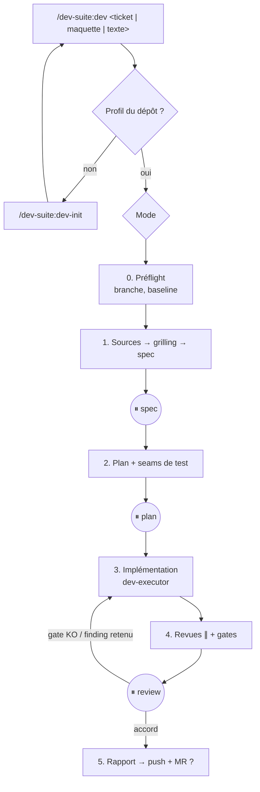

Principes :

- **La session décide, les agents exécutent.** Le spec, le plan, le diagnostic et la présentation des revues restent dans la session principale. Le code est écrit par `dev-executor` ; les revues sont faites par des agents en contexte neuf.
- **Trois pauses obligatoires** : après le spec, après le plan, après la review. Rien n'avance sans ton accord.
- **Tout finit en commit local.** Push et MR/PR uniquement sur un oui explicite, demandé à chaque fois.
- **Un seul workflow, un profil par dépôt.** Le générique vit dans le plugin ; les commandes, conventions et pièges du projet vivent dans `~/.claude/dev-profiles/<nom>/`.

## 2. Démarrage : résolution du profil

Au lancement, `dev` cherche le profil dans cet ordre :

1. argument explicite `profil=<nom>` ;
2. un `~/.claude/dev-profiles/*/profile.md` dont la section `match` contient l'URL de `git remote get-url origin` ;
3. … ou le nom du dossier racine du dépôt.

Aucun profil trouvé → `dev` propose `/dev-suite:dev-init` et s'arrête.

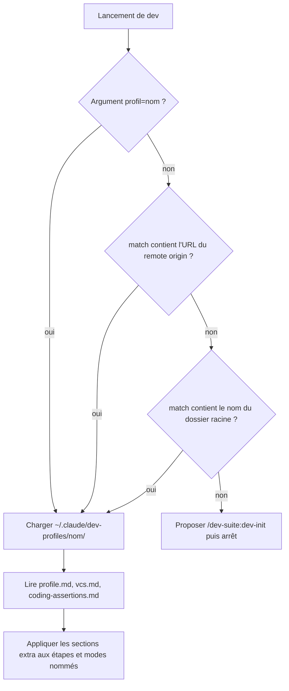

Une fois trouvé, il lit `profile.md`, `vcs.md` et `coding-assertions.md`. Les règles du profil (section `extra`) s'ajoutent à l'étape ou au mode qu'elles nomment ; en cas de contradiction, **le profil gagne**.

### Créer un profil avec `dev-init`

1. Lecture du dépôt sans rien demander : remotes, branche par défaut, format des 30 derniers commits, scripts (`package.json`, `Makefile`…), commitlint et hooks, `CLAUDE.md`, `CONTRIBUTING.md`, CI, outil de MR installé (`gh`, `glab`).
2. Questions (`dev-grill`) uniquement sur ce qui ne se déduit pas : tracker, outil de maquette, base des hotfix, gates, niveau de sécurité, spécificités.
3. Écriture de `~/.claude/dev-profiles/<nom>/` (3 fichiers). **Rien n'est écrit dans le dépôt.**

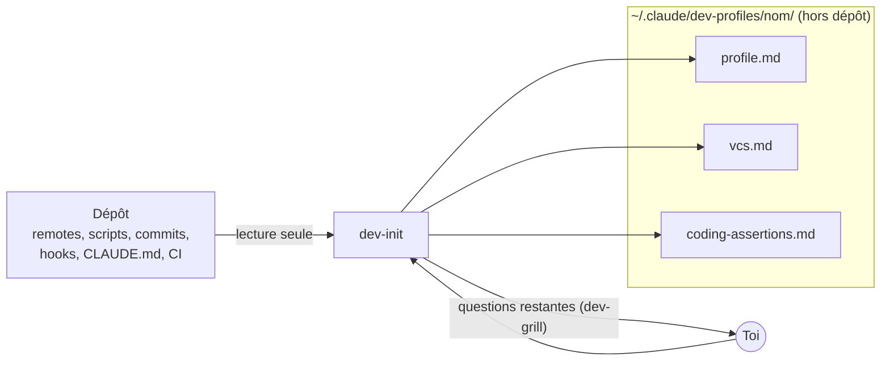

## 3. Les étapes 0 à 5

### Étape 0 — Préflight

| Action | Détail |
|---|---|
| Titre de session | `<ticket> <ce qui va être fait>`, si l'outil de titre existe. |
| Travail déjà entamé ? | `git ls-remote --heads` filtré sur le ticket + statut et assigné du tracker. Branche existante ou autre dev assigné → question sur la base. |
| Branche | Branche simple par défaut (`git status` doit être vide), `<prefix>/<ticket>-<slug>` depuis la base. Worktree **seulement sur demande**, toujours hors du dépôt. |
| Dossier de tâche | Ajouté à `.git/info/exclude`. |
| Baseline | Sortie du typecheck et liste des tests en échec, dans le scratchpad. Les gates comparent à cette baseline : on n'exige pas un vert absolu préexistant. |

Lancé en plan mode, `dev` fait d'abord la collecte en lecture seule (étapes 1 et 2), puis le préflight git une fois le plan validé.

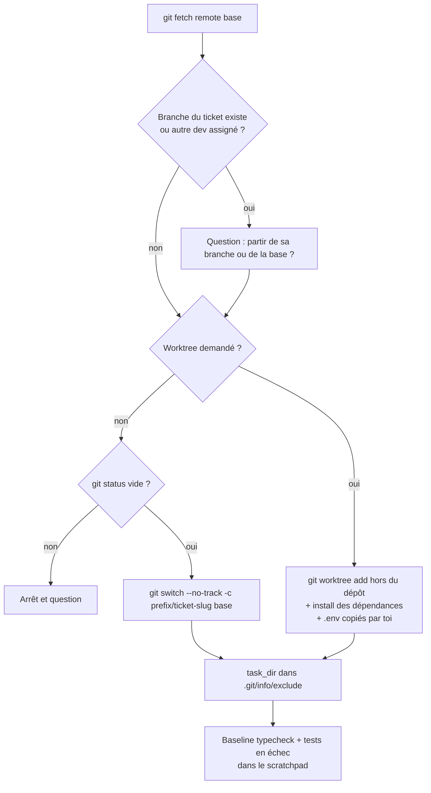

### Étape 1 — Sources → spec

1. **Tracker** : description, **tous les commentaires**, tous les champs, rendu HTML (pour les liens cachés derrière un texte), liens distants. On en tire l'objectif, les critères d'acceptation et le type (qui fixe le mode).
2. **Maquettes** : toutes les URLs collectées partout (epic et enfants compris), dédupliquées, affichées avec leur source. Plusieurs liens pour un écran → question. Lien illisible → arrêt : pas d'UI implémentée « à l'œil ». Les screenshots servent de référence à l'étape 4.
3. **Grilling** (`dev-grill`) : questions par rounds de 5 maximum, chacune avec une réponse recommandée. Les faits (code, config, maquette) sont cherchés par Claude, jamais demandés. Fin quand aucune décision ne reste ouverte.
4. **Spec** écrit dans le dossier de tâche : objectif, AC, décisions, hors périmètre, « Points remontés ».

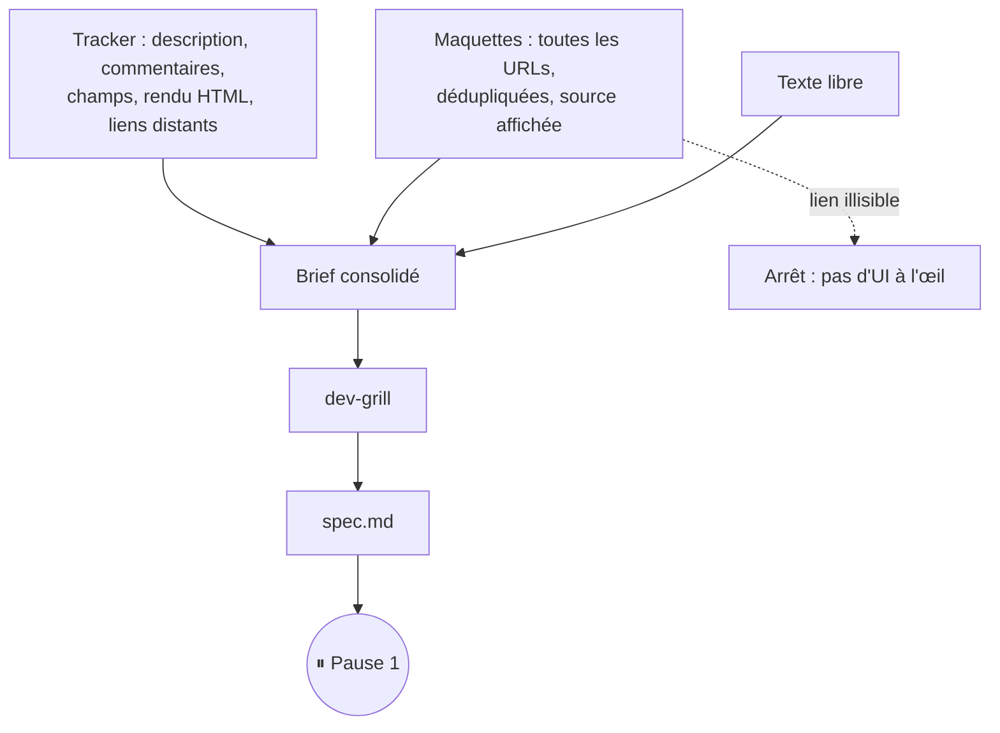

Le grilling, round par round :

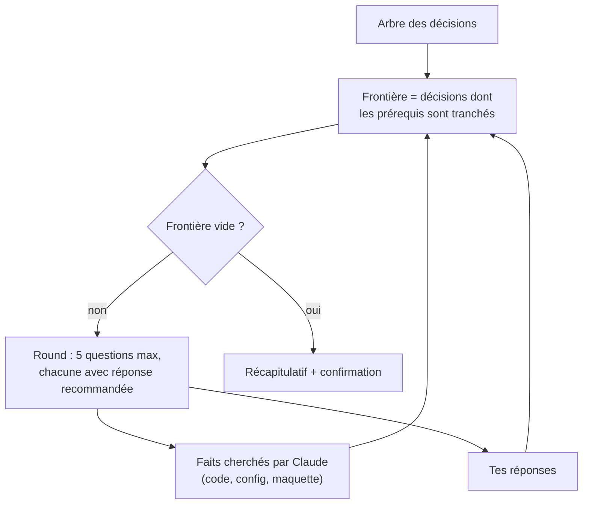

⏸ **Pause 1 : accord sur le spec.**

### Étape 2 — Plan

- Phases ordonnées, fichiers touchés, réutilisation de l'existant, impacts listés par le profil, docs à mettre à jour.
- Toute omission par rapport au ticket ou à la maquette est listée et soumise.
- **Seams de test** : les interfaces publiques qui seront testées, au plus haut niveau possible. Si rien n'est à tester (mise en page pure), c'est écrit.

⏸ **Pause 2 : accord sur le plan.**

### Étape 3 — Implémentation

`dev` note le sha courant (`<sha avant>`), puis lance `dev-executor` avec : le plan et la phase, les chemins de `vcs.md` et `coding-assertions.md`, les commandes du profil, les seams validés.

L'executor travaille en **TDD par tranches verticales** : un test rouge → le code minimal → le test suivant. Typecheck et test ciblé après chaque tranche, suite complète à la fin, un commit par unité logique selon `vcs.md`.

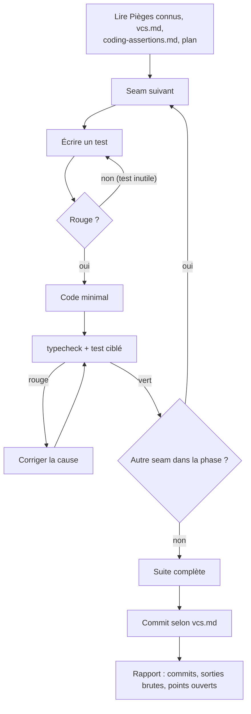

Tout point ouvert (décision produit, limite, contenu à corriger, ordre de livraison) est ajouté à « Points remontés » au fil de l'eau.

### Étape 4 — Revues + gates

Trois revues **en parallèle**, en lecture seule, sur `<sha avant>..HEAD` (voir [§7](#7-les-revues-et-les-gates)), puis les gates du profil.

Gate KO, finding retenu, ou finding sécurité critique/haut → retour à l'étape 3 avec la liste ; les revues sont relancées sur le diff des correctifs.

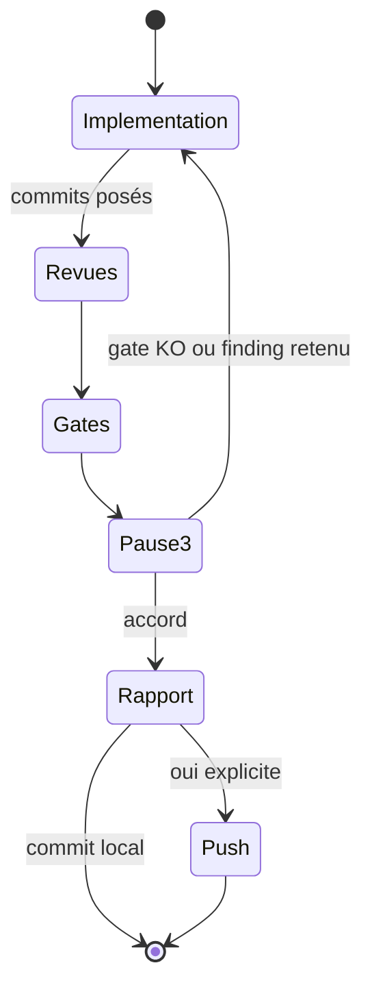

⏸ **Pause 3 : accord sur la review.**

### Étape 5 — Fin

Rapport :

- commits (`git log --oneline <base>..HEAD`), fichiers touchés ;
- actions à faire par toi (migrations, contenu…), numérotées, avec la commande exacte et une estimation ;
- ordre de livraison, points non vérifiés, « Points remontés ».

Puis **une seule question : push + MR ?**

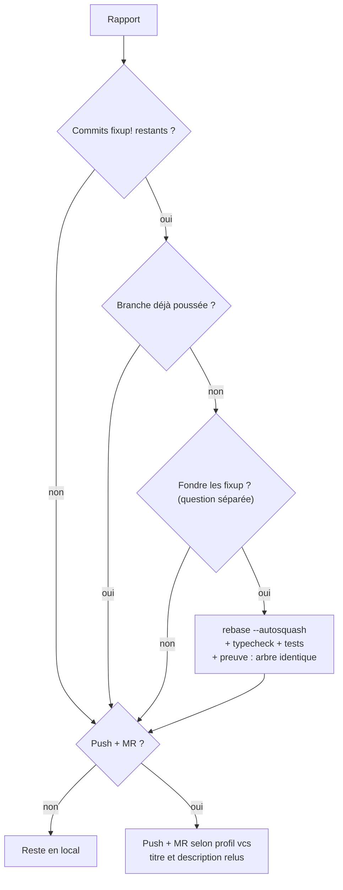

S'il reste des commits `fixup!`, une question séparée propose d'abord `git rebase -i --autosquash <base>` — uniquement si la branche n'a jamais été poussée — avec relance du typecheck et des tests, et preuve que l'arbre final est identique. Branche déjà poussée : jamais de force push.

## 4. Les pauses

Format fixe pour qu'elles se lisent vite :

- **Première ligne = l'état** : « Étape 2/5 — plan. À valider : … ».
- **5 décisions au maximum**, les plus bloquantes d'abord ; le reste en « pour info ». Le détail reste dans les fichiers du dossier de tâche, cités par chemin.
- **Review** : les gates passées en une ligne, puis seulement les findings à trancher.
- **Rapport final** : actions numérotées avec durée estimée, puis la question push + MR.

Une liste de tâches (une par étape, une seule en cours) affiche la progression.

## 5. Les modes

| Mode | Déclencheur |
|---|---|
| Feature | par défaut (story, tâche, maquette, texte) |
| Bug | ticket de type Bug, ou description d'un dysfonctionnement |
| Epic | ticket de type Epic |
| POC | argument `poc`, type Spike, ou « POC » dans le résumé ou les labels |

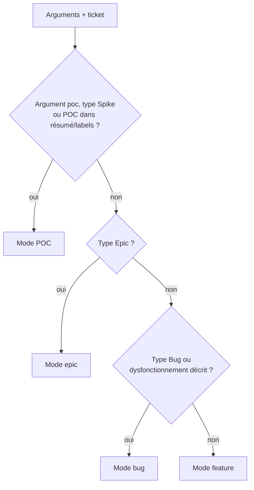

### Mode bug

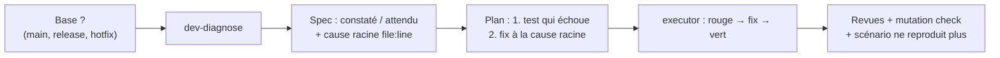

Le diagnostic (`dev-diagnose`) :

1. **Boucle de feedback d'abord** : une commande unique, déjà exécutée, qui reproduit le symptôme exact — rapide, déterministe, lançable sans humain. Pas d'hypothèse avant.
2. **Réduction** du scénario jusqu'au minimum qui reproduit.
3. **3 à 5 hypothèses** classées et falsifiables, montrées avant d'être testées.
4. **Instrumentation** ciblée, une variable à la fois, logs préfixés `[DEBUG-xxxx]`.
5. **Cause racine vérifiée** dans le fichier réel, et liste de tous les appelants : le correctif va dans le code partagé.
6. **Test de non-régression avant le fix**, au bon seam. Pas de seam correct → c'est signalé comme finding, pas de test factice.
7. **Nettoyage** : `grep DEBUG-xxxx` vide, hypothèse confirmée dans le corps du commit.

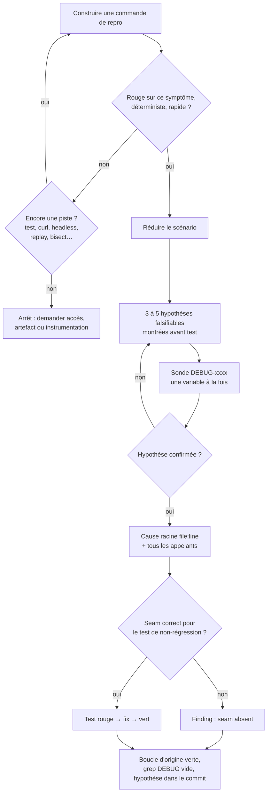

Mutation check du checker :

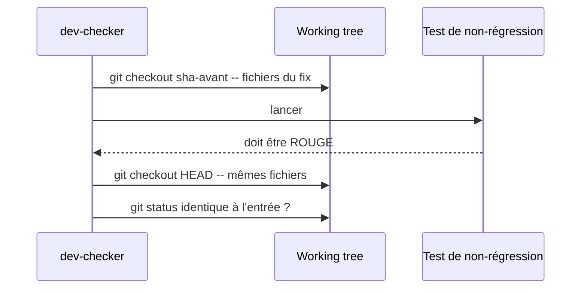

En review, `dev-checker` fait un **mutation check** : il remet le code fautif, vérifie que le test échoue, puis restaure.

### Mode epic

1. Tickets enfants via le tracker (ou liste demandée).
2. Collecte des maquettes sur l'epic et chaque enfant.
3. `epic.md` : tickets, ordre, dépendances, fichiers touchés par ticket.
4. ⏸ Choix d'exécution + specs en bloc ou ticket par ticket.

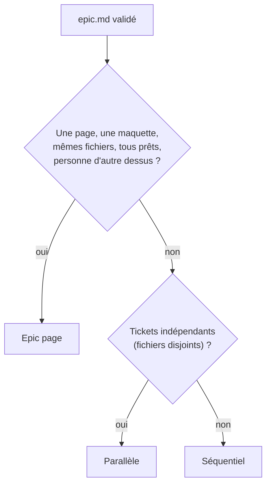

Branches en mode parallèle :

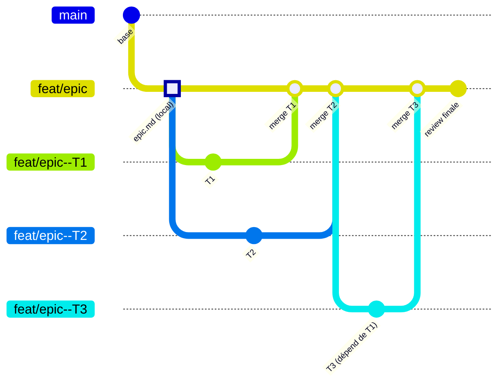

| Exécution | Quand | Comment |
|---|---|---|
| **Epic page** | une page, une maquette, mêmes fichiers, tous les tickets prêts, personne d'autre dessus | un spec et un plan pour toute la page, une phase et un commit par ticket enfant, une review sur tout le diff |
| **Séquentiel** | par défaut | étapes 1 à 4 ticket par ticket sur la branche d'epic |
| **Parallèle** | tickets indépendants | une session + un worktree hors dépôt par ticket, sous-branche `feat/<epic>-<slug>--<ticket>`, merge `--no-ff` dans la branche d'epic sur accord ; deux tickets qui touchent les mêmes fichiers ne tournent jamais en même temps |

Review finale sur toute l'epic : `dev-checker` contre `epic.md`, `dev-reviewer` en opus (duplication et incohérences entre tickets), `dev-security` selon le profil. Les commits référencent le **ticket enfant**.

### Mode POC

- Spec = une hypothèse + des critères de succès mesurables. Plan = le minimum qui prouve ou réfute.
- Relâché : seulement les tests qui prouvent l'hypothèse (la gate « aucun nouvel échec » reste), `dev-reviewer` limité aux bugs avérés.
- Inchangé : les 3 pauses, typecheck à 0, vérif visuelle si maquette, commits conventionnels.
- Rapport `poc-report.md` : verdict (validée / invalidée / partielle) avec preuves, raccourcis pris, ce qu'il faut pour la vraie feature avec estimation.
- **Jamais de MR vers la branche principale** ; push de la branche `poc/` seulement sur oui.

## 6. Les agents

| Agent | Modèle | Écrit ? | Rôle |
|---|---|---|---|
| `dev-executor` | sonnet (opus si le profil le demande) | oui : code + commits | Implémente une phase. TDD aux seams validés. Ne crée pas de branche, ne pousse jamais, ne se déclare pas « terminé ». |
| `dev-checker` | opus | non (sauf mutation check, restauré) | Conformité : chaque AC, phase et élément de maquette marqué rempli / partiel / non rempli avec preuve. |
| `dev-reviewer` | sonnet (opus en review finale d'epic) | non | Qualité sans connaître le spec : bugs, règles du projet, réutilisation, code mort, smells. |
| `dev-security` | opus | non | Audit sécurité du diff, optionnel. |

Qui fait quoi sur un ticket :

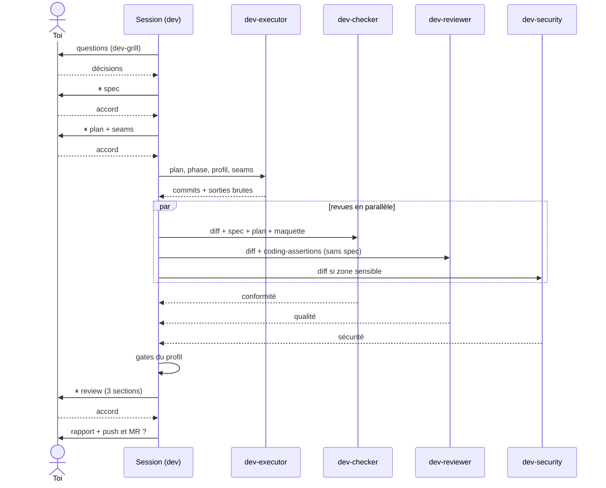

Les modèles sont fixés à chaque appel ; `haiku` n'est jamais utilisé. Le profil peut les surcharger (section `models`).

Pourquoi `dev-reviewer` ne voit pas le spec : un relecteur qui connaît l'intention lit le code à travers elle et laisse passer ce qui « devrait » marcher. Le regard non ancré attrape ce que le checker, ancré sur le spec, ne voit pas.

## 7. Les revues et les gates

### Trois axes, jamais fusionnés

| Axe | Agent | Référentiel |
|---|---|---|
| **Conformité** | `dev-checker` | spec, plan, AC, screenshots de maquette |
| **Qualité** | `dev-reviewer` | `coding-assertions.md` + baseline de smells |
| **Sécurité** | `dev-security` | OWASP Top 10 / ASVS appliqués au diff + règles du profil |

Les findings sont présentés en sections séparées, avec une ligne de synthèse par axe. Une fusion classerait tout sur une seule échelle et masquerait un axe par l'autre (un code propre qui fait la mauvaise chose, ou l'inverse).

### Quand l'audit sécurité tourne

Section `security` du profil :

- `off` : jamais (sauf demande explicite « sécu ») ;
- `auto` (défaut) : seulement si le diff touche une zone sensible — entrées utilisateur et formulaires, appels API et en-têtes, auth/session/cookies, `postMessage`/iframes/allowlists d'origine, rendu HTML brut, dépendances et lockfile, CI et déploiement, variables d'env et secrets ;
- `always` : à chaque review.

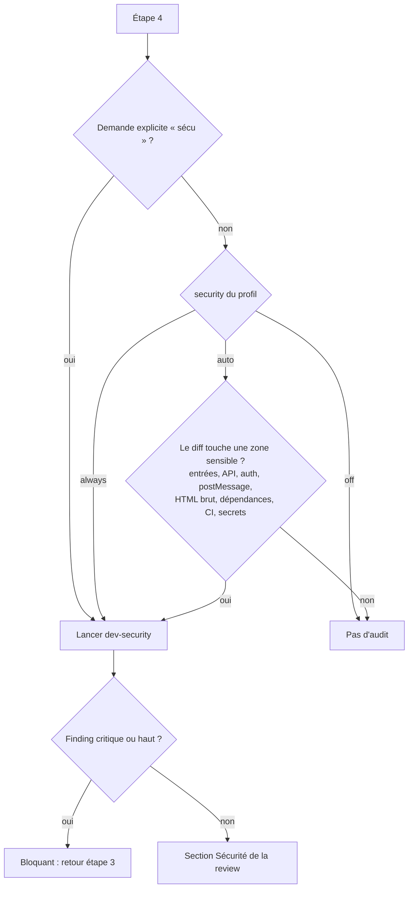

Chaque finding a une sévérité, un `file:line`, un **scénario concret** et un correctif. Critique ou haute = bloquant.

### Gates

Celles du profil (section `gates`), toutes exigées. Par défaut :

1. typecheck : 0 erreur ;
2. tests : aucun nouvel échec vs baseline ;
3. build(s) OK (séquentiels si le profil le dit) ;
4. vérif visuelle vs maquette s'il y a une UI : rendu, DOM, comportement, textes — jamais « pixel-perfect » sans l'avoir vérifié ;
5. docs à jour si un comportement documenté change.

Une gate qui ne peut pas être faite (environnement manquant, contenu absent) est déclarée **non faite**, jamais validée par défaut.

## 8. Le dossier de tâche

`<task_dir>/<yyyy_mm>/<yyyy_mm_dd>_<ticket>-<slug>/` (défaut `task_dir` : `.dev/tasks/`), exclu de git par `.git/info/exclude`, jamais commité.

| Fichier | Écrit à |
|---|---|
| `spec.md` (avec « Points remontés ») | étape 1, complété jusqu'à la fin |
| `plan.md` (avec les seams de test) | étape 2 |
| `epic.md` + un sous-dossier par ticket | mode epic |
| `poc-report.md` | mode POC |

## 9. Le profil

`~/.claude/dev-profiles/<nom>/`, hors de tout dépôt. Exemple complet : [`profiles/example/`](../profiles/example/).

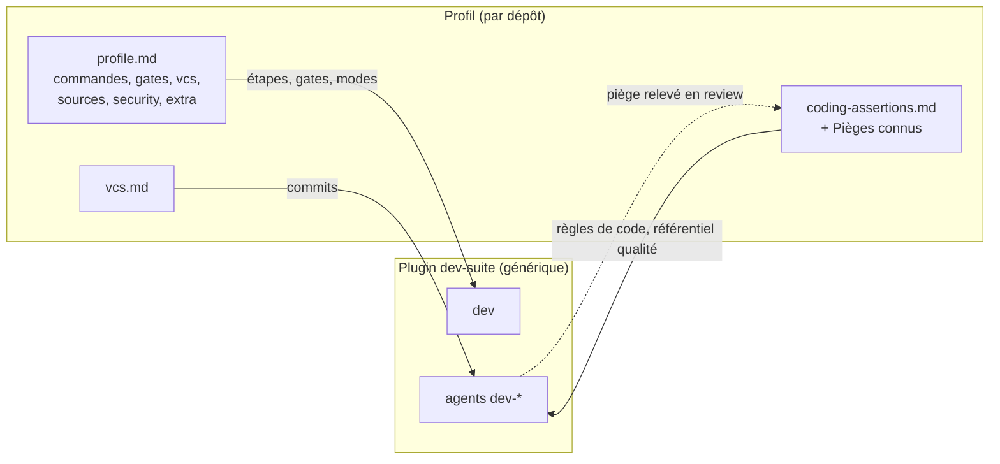

### `profile.md`

| Section | Obligatoire | Contenu |
|---|---|---|
| `match` | oui | URL(s) du remote et/ou nom du dossier racine |
| `commands` | oui | typecheck, test ciblé, tests, build(s) (séquentiels ?), dev server |
| `gates` | non | liste ordonnée exigée avant le ship |
| `vcs` | non | remote de MR, base, préfixes de branche, création de MR (`gh`, `glab`, push options), hotfix et reports |
| `sources` | non | tracker (et comment le lire), outil de maquette |
| `task_dir` | non | défaut `.dev/tasks/` |
| `security` | non | `off`, `auto` ou `always` + règles propres au projet |
| `models` | non | surcharges de modèle par agent ou type de travail |
| `extra` | non | sous-sections `### Étape n — …` ou `### Mode … — …` ajoutées à l'étape ou au mode nommé |

### `vcs.md`

Format des messages (convention, langue, longueur, référence au ticket), commande de commit sûre (`git add -- <fichiers>`, `git commit … -- <fichiers>`, `git show --stat HEAD`), politique `fixup!`, interdits (`--amend`, `--no-verify`, push sans oui).

### `coding-assertions.md`

Architecture et couches, conventions, règles de test, hygiène, et surtout **« Pièges connus »** : chaque erreur relevée en review y est ajoutée, et l'executor la lit en premier à chaque tâche. C'est là que le workflow apprend du projet.

### Faire évoluer un profil

- Une règle propre au projet → le profil, jamais le plugin.
- Un piège relevé en review → une ligne dans « Pièges connus ».
- Une étape à ajouter pour ce projet → une sous-section `extra`.

## 10. Garde-fous

- Aucun push, aucune MR/PR sans un oui explicite, demandé à chaque fois.
- Aucune trace d'assistant IA dans les commits, MR et commentaires du tracker.
- Jamais de lecture de `.env*` ; jamais de commande avec un token secret (elle t'est donnée à lancer).
- Pas de worktree sans demande ; jamais d'outillage perso (scripts de vérif) dans le dépôt : scratchpad.
- Jamais `--amend` ni `--no-verify` ; commits limités à ses propres fichiers (`-- <fichiers>`) pour cohabiter avec d'autres sessions.
- Les revues sont en lecture seule ; seul `dev-executor` corrige.

## 11. Dépannage

| Symptôme | Cause | Action |
|---|---|---|
| « Aucun profil » | `match` ne correspond ni au remote ni au dossier | `/dev-suite:dev-init`, ou ajouter l'URL exacte de `git remote get-url origin` dans `match` |
| Agents `dev-*` introuvables | session ouverte avant l'installation | redémarrer la session |
| Skills en double | copies locales dans `~/.claude/skills` en plus du plugin | supprimer les copies locales |
| Gate « non faite » | environnement ou contenu de test absent | fournir l'environnement demandé dans le rapport, puis relancer la review |
| Mise à jour du plugin | — | `/plugin marketplace update dev-suite` |
